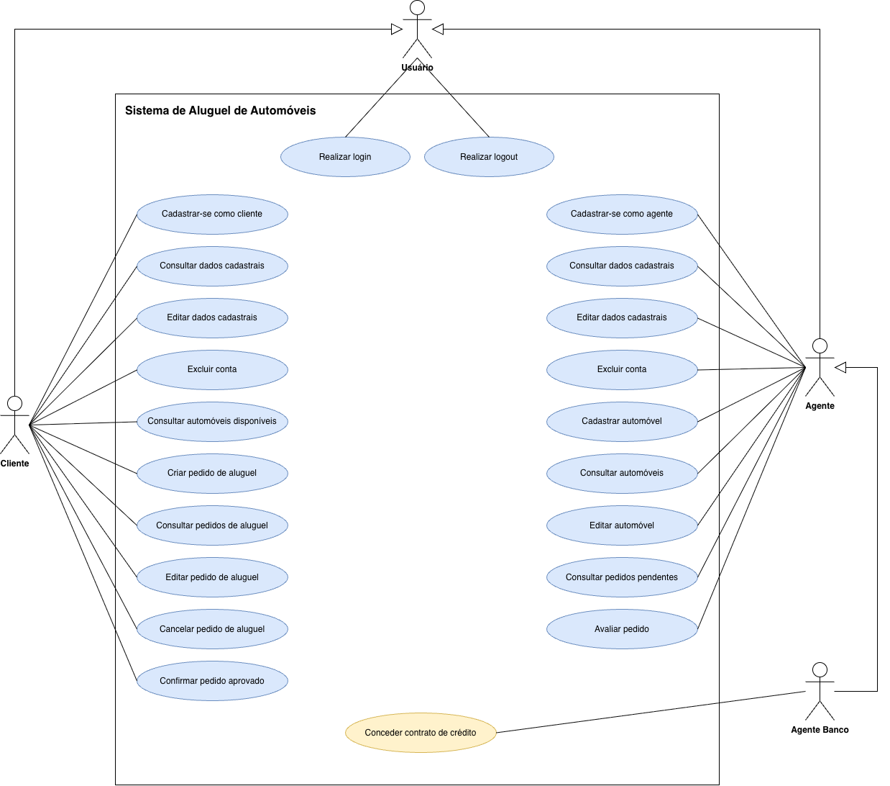
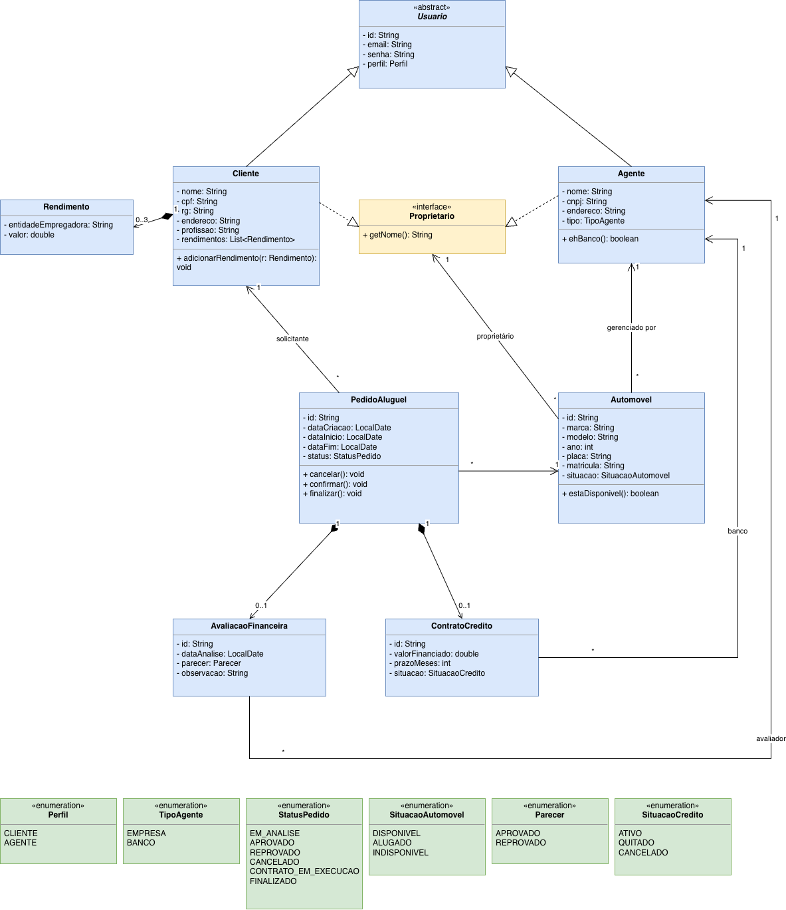

# 🚗 Sistema de Aluguel de Automóveis 👨‍💻

> [!NOTE]
> Sistema web para gestão de pedidos de aluguel de automóveis, com **análise financeira dos pedidos** por empresas e bancos.

---

## 🚧 Status do Projeto

---

## 📝 Sobre o Projeto

Projeto acadêmico do curso de **Engenharia de Software da PUC Minas**. O sistema permite que **clientes** solicitem o aluguel de automóveis e que **agentes** (empresas e bancos) analisem financeiramente esses pedidos. Bancos também podem conceder **contratos de crédito**.

### Perfis de acesso

| Perfil | Responsabilidades |
|---|---|
| 🙋 **Cliente** | Realiza seu cadastro, consulta automóveis disponíveis e mantém seus próprios pedidos de aluguel. |
| 🏢 **Agente** | Instituição (empresa ou banco) que cadastra seus automóveis e realiza a análise financeira dos pedidos. |
| 🏦 **Agente Banco** | Tudo o que o agente faz, e também concede contratos de crédito. |

---

## 📐 Modelagem

| Artefato | Link |
|---|---|
| Casos de Uso | [docs/casos-de-uso.md](docs/casos-de-uso.md) |
| Histórias de Usuário | [docs/historias-de-usuario.md](docs/historias-de-usuario.md) |
| Diagrama de Casos de Uso | [docs/diagramas/casos-de-uso.png](docs/diagramas/casos-de-uso.png) |
| Diagrama de Classes | [docs/diagramas/classes.png](docs/diagramas/classes.png) |

### Diagrama de Casos de Uso

### Diagrama de Classes

---

## 👥 Autores

| 👤 Nome | :octocat: GitHub |
|---------|-----------------|
| Luis | [LuisFernandodeSousaDias0](https://github.com/LuisFernandodeSousaDias0) |